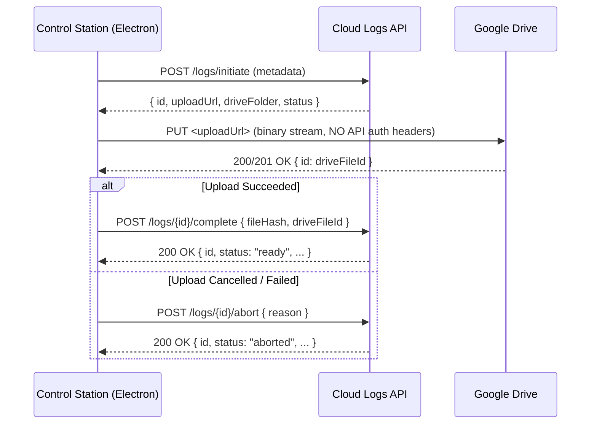

# Cloud Logs integration

Desktop service shared by Logging View and Testing View via
`window.electronAPI.cloudLogs`. The typed contract is exported from
`@hyperloopupv/frontend-kit/core` (`CloudLogsAPI`). React never imports Node code.

## File map

| File                         | Responsibility                                                                                                                                                                                              | Change it when…                                                                                 |
| ---------------------------- | ----------------------------------------------------------------------------------------------------------------------------------------------------------------------------------------------------------- | ----------------------------------------------------------------------------------------------- |
| `client.js`                  | The remote HTTP adapter. Implements `listLogs`, `autocompleteTags`, two-phase `uploadLog`, direct streaming `downloadLog`, and error sanitization.                                                          | Modifying API endpoints, authentication headers, error serialization, or upload/download flows. |
| `credentials.js`             | Reads, writes, encrypts, and clears the Cloud Logs user and API key. Only credential status is returned to the renderer.                                                                                    | Changing credential persistence, secure-storage policy, or validation.                          |
| `sessions.js`                | Resolves the configured `logger/` root, creates `cloud-logs/`, scans local launch folders, and validates a recording using its `logger_settings.json`. Formats archive filenames by title/standard date.    | Changing how backend recordings are laid out, session validation, or archive naming rules.      |
| `archive.js`                 | Zips every regular file inside one recording and safely extracts downloaded archives with cross-platform attribute handling. Reports compression and extraction progress.                                   | Changing archive layout, ZIP safety checks, limits, or progress.                                |
| `handlers.js`                | Connects renderer IPC calls to credentials, session discovery, archive operations, and the remote adapter. Checks the calling window, owns local path grants, scopes progress, and removes temporary files. | Adding renderer operations, changing authorization, or coordinating uploads and downloads.      |
| `__tests__/client.test.js`   | Unit tests for the HTTP client adapter (URL parsing, authentication, upload phases, download streaming, Pydantic error formatting, sanitization).                                                           | Adding regression tests for remote API interactions.                                            |
| `__tests__/handlers.test.js` | Unit tests for the Cloud Logs IPC handlers (authentication guards, upload/download input validation, title propagation, and error redaction).                                                               | Adding regression tests for IPC bridge logic.                                                   |
| `__tests__/storage.test.js`  | Tests local session discovery, ZIP round trips and safety, archive naming, arbitrary logger subfolders, and credential storage using temporary files.                                                       | Adding regression coverage for session storage, ZIP handling, or credentials.                   |
| `README.md`                  | This module guide and API handoff contract.                                                                                                                                                                 | Updating module behavior or integration instructions.                                           |

Related bridge files live outside this directory: `electron-app/preload.js`
exposes `window.electronAPI.cloudLogs`; `frontend/frontend-kit/kit/src/core/cloudLogs.ts`
defines the shared TypeScript contract; and
`frontend/logging-view/src/components/cloudLogs/CloudLogsDialog.tsx` implements
the Logging View dialog. Testing View can use the same preload bridge and types.

## Remote API: Architecture & Endpoints

The remote telemetry storage service is implemented in [`Hyperloop-UPV/cloud-logs`](https://github.com/Hyperloop-UPV/cloud-logs).
All client methods in `client.js` are fully connected and tested:

| Function           | Input                                       | Result                                         |
| ------------------ | ------------------------------------------- | ---------------------------------------------- |
| `listLogs`         | credentials, optional cursor                | `{ items: CloudLog[], nextCursor?: string }`   |
| `autocompleteTags` | credentials, query (including empty string) | `string[]`                                     |
| `uploadLog`        | credentials, archivePath, metadata          | confirmed `CloudLog`                           |
| `downloadLog`      | credentials, id, destination, maxBytes      | resolves after ZIP is fully written and closed |

The desktop application contract defines:

- `CloudLog`: `{ id: string, user: string, notes: string, tags: string[], date: string, title?: string, fileName?: string }`.
- `DownloadedLog`: `{ id: string, path: string, date: string, title?: string, fileName?: string }`.

### Configuration & Base URL

- **Production Base URL**: `https://cloud-logs.hyperloopupv.com/api/v1`
- **Configuration**: Overridable via `CLOUD_LOGS_API_URL` environment variable or `config.toml` (e.g. `[cloud_logs] api_url = "https://..."`).

### Authentication

Every authenticated request to the Cloud Logs API must provide the user's API key using either:

- `Authorization: Bearer <apiKey>` (standard HTTP bearer token), or
- `X-API-Key: <apiKey>` (machine/automated header).

Both header formats are accepted interchangeably by the API server.

### Date Format Mapping

- **Local Logger format**: `YYYY-MM-DDTHH-mm-ss` (e.g., `2026-11-15T12-30-00`, read from `logger_settings.json.date`).
- **Cloud Logs API format**: ISO-8601 UTC string `YYYY-MM-DDTHH:mm:ssZ` (e.g., `2026-11-15T12:30:00Z`).
- **Conversion rule**:
  - Convert from local logger to API when uploading:
    ```js
    const isoDate = date.replace(
      /^(\d{4}-\d{2}-\d{2}T\d{2})-(\d{2})-(\d{2})$/,
      "$1:$2:$3Z",
    );
    ```
  - Convert from API back to local logger format when listing/downloading:
    ```js
    const loggerDate = isoDate.replace(
      /^(\d{4}-\d{2}-\d{2}T\d{2}):(\d{2}):(\d{2})(?:\.\d+)?Z?$/,
      "$1-$2-$3",
    );
    ```
  - **Important**: Do **NOT** use `new Date(...)` or `.toISOString()` for this transformation. Local dates must not have timezones or local daylight-saving offsets invented for them; the nominal recorded time is converted directly.

---

### Real Endpoints Specification

#### 1. Catalog Search & Pagination

- **Method**: `GET /logs` (or `GET /api/v1/logs`)
- **Query Parameters**:
  - `page`: Page index (integer, default: `1`).
  - `pageSize`: Items per page (integer, default: `50`, max: `100`).
  - `sortBy`: Field to order by (`uploadDate`, `logDate`, `fileName`, `fileSize`, default: `uploadDate`).
  - `sortOrder`: Sort direction (`asc` or `desc`, default: `desc`).
  - `fromDate`: (Optional) Filter logs from this ISO date.
  - `toDate`: (Optional) Filter logs up to this ISO date.
  - `tags`: Comma-separated list of required tags (e.g. `pod,propulsion`).
  - `status`: Filter by state (`ready`, `pending_upload`, `aborted`, `failed`, default: `ready`).
  - `textQuery`: (Optional) Substring search in filenames and notes.
- **Response Schema (`200 OK`)**:
  ```json
  {
    "total": 42,
    "page": 1,
    "pageSize": 20,
    "items": [
      {
        "id": "c8b321a0-3841-4cf1-a472-8d76a26d7f01",
        "fileName": "run_42_telemetry.zip",
        "status": "ready",
        "driveFolder": "2026_10",
        "driveFileId": "1aB2cD3e...",
        "driveUrl": "https://drive.google.com/file/d/1aB2cD3e.../view",
        "fileSize": 104857600,
        "fileHash": "a1b2c3d4...",
        "tags": ["pod", "propulsion"],
        "note": "Track run with inverter at 80% throttle",
        "clientMetadata": {
          "hostname": "pod-orin-master-01",
          "clientUser": "operator_john"
        },
        "logDate": "2026-10-23T10:00:00Z",
        "createdBy": "a3b1c2d3-...",
        "creator": "john_eng",
        "uploadDate": "2026-10-23T10:00:02Z",
        "completedAt": "2026-10-23T10:01:10Z"
      }
    ]
  }
  ```
- **Mapping to `CloudLog`**:
  Map each item in `items` to:
  ```js
  {
    id: item.id,
    fileName: item.fileName || item.file_name || "",
    title:
      item.title ||
      item.clientMetadata?.title ||
      (item.fileName ? item.fileName.replace(/\.zip$/i, "") : ""),
    user: item.creator || item.user || item.clientMetadata?.clientUser || credentials.user,
    notes: item.note || item.notes || "",
    tags: item.tags || [],
    date: item.logDate || item.uploadDate || item.fileDate || item.date || item.createdAt || "",
  }
  ```
  Set `nextCursor` to `page < Math.ceil(total / pageSize) ? String(page + 1) : undefined`.

#### 2. Tag Autocomplete

- **Method**: `GET /logs/tags`
- **Query Parameters**:
  - `detailed`: Boolean (default: `false`).
- **Response Schema (`200 OK`)**:
  ```json
  ["bms", "brakes", "inverter", "motor", "pod", "propulsion", "telemetry"]
  ```
  If `query` is provided in `autocompleteTags`, filter suggestions locally or pass query parameter if supported.

#### 3. Two-Phase Resumable Upload to Google Drive

Telemetry binaries stream directly to Google Drive via pre-authenticated resumable upload sessions. They are **never sent directly through the Cloud-Logs API server**.



##### Step 3.1: Request Upload Session & Register Metadata

- **Method**: `POST /logs/initiate` (or `POST /api/v1/logs/initiate`)
- **Request Fields**:
  - `fileName`: string (required) - Name of the ZIP archive (`<title>.zip` or `<standard-date>.zip`).
  - `fileSize`: integer (required) - Archive size in bytes.
  - `logDate`: ISO datetime string (`YYYY-MM-DDTHH:mm:ssZ`) - Creation/recording date from `logger_settings.json`.
  - `tags`: string array (optional) - Tags associated with the recording.
  - `note`: string (optional) - User description or notes.
  - `clientMetadata`: object (optional) - Client environment details (e.g., `hostname`, `clientUser`, `title`, `appVersion`).
- **Request Body**:
  ```json
  {
    "fileName": "run_42_telemetry.zip",
    "fileSize": 104857600,
    "logDate": "2026-10-23T10:00:00Z",
    "tags": ["pod", "propulsion"],
    "note": "Track run with inverter at 80% throttle",
    "clientMetadata": {
      "hostname": "pod-orin-master-01",
      "clientUser": "operator_john",
      "title": "Run 42 Telemetry",
      "appVersion": "1.0.0"
    }
  }
  ```
- **Response Schema (`200 OK`)**:
  ```json
  {
    "id": "c8b321a0-3841-4cf1-a472-8d76a26d7f01",
    "uploadUrl": "https://www.googleapis.com/upload/drive/v3/files?uploadType=resumable&upload_id=...",
    "driveFolder": "2026_10",
    "status": "pending_upload",
    "expiresInSeconds": 86400
  }
  ```

##### Step 3.2: Direct Binary Stream to Google Drive

- **Method**: `PUT <uploadUrl>`
- **Headers**: Standard HTTP body stream headers (`Content-Length: <fileSize>`, `Content-Type: application/zip`).
- **CRITICAL**: Do **NOT** send `Authorization` or `X-API-Key` headers to `uploadUrl`. The Google Drive upload URL is already signed/pre-authenticated. Forwarding API keys to Google will cause request failure or credential leakage.
- Stream the ZIP archive directly from `archivePath` using Node streams.

##### Step 3.3: Complete & Verify Upload

- **Method**: `POST /logs/{id}/complete`
- **Request Body**:
  ```json
  {
    "fileHash": "optional_client_calculated_sha256",
    "driveFileId": "optional_google_drive_file_id"
  }
  ```
- **Response Schema (`200 OK`)**:
  ```json
  {
    "id": "c8b321a0-3841-4cf1-a472-8d76a26d7f01",
    "status": "ready",
    "driveUrl": "https://drive.google.com/file/d/.../view",
    "driveFolder": "2026_10",
    "fileName": "run_42_telemetry.zip",
    "fileSize": 104857600,
    "message": "Upload verified and completed successfully"
  }
  ```
- Maps to confirmed `CloudLog` on resolution.

##### Step 3.4: Abort Upload (Cancellation)

- **Method**: `POST /logs/{id}/abort`
- **When to call**: If transfer is cancelled or an unrecoverable network failure occurs after initiate.
- **Request Body**:
  ```json
  {
    "reason": "Cancelled by user"
  }
  ```
- **Response Schema (`200 OK`)**:
  ```json
  {
    "id": "c8b321a0-3841-4cf1-a472-8d76a26d7f01",
    "status": "aborted",
    "message": "Upload aborted successfully",
    "abortedAt": "2026-10-24T08:30:00Z"
  }
  ```

#### 4. File Download (Direct Streaming / 307 Fallback)

- **Method**: `GET /logs/{id}/download` (or `GET /api/v1/logs/{id}/download`)
- **Behavior**:
  - Validates authentication (`Authorization: Bearer <apiKey>` or `X-API-Key: <apiKey>`).
  - Streams the binary ZIP content directly with `200 OK` (via backend Google Drive streaming).
  - Also handles HTTP redirect responses (`301`, `302`, `307`, `308`) by following `Location` headers (resolved with `new URL(location, downloadEndpoint)`).
  - **CRITICAL Security**: Never forward authorization headers (`Authorization` or `X-API-Key`) to external redirects or third-party hosts.
  - Enforces `maxBytes` (default 2–4 GiB) while streaming the response into the destination file.
  - If the log is not in `ready` state, the endpoint returns `400 Bad Request`; if nonexistent, `404 Not Found`.

---

### Adapter Guidelines & Error Handling in `client.js`

- Stream files directly via Node streams instead of buffering entire archives in memory.
- Enforce `maxBytes` byte limits during streaming downloads to prevent disk saturation.
- Never forward authentication headers to third-party domains or external redirects (such as Google Drive).
- Sanitize error messages: redact API keys (`Bearer [REDACTED]`, `x-api-key: [REDACTED]`), strip raw HTML dumps, and serialize FastAPI/Pydantic 422 validation detail arrays/objects into readable JSON instead of `[object Object]`.

## Local service (implemented)

- Local discovery: `<logging_path>/logger/<app-launch>/<recording>/`.
- Native folder selection also permits recordings outside that root. The main
  process gives the renderer an opaque token scoped to its window, not a generic
  "upload any path" API.
- One recording per ZIP. `logger_settings.json` stays at the ZIP root, and every
  regular file inside that recording is included, even in unrecognized or future
  subfolders such as `orders/`, `protections/`, and `other/`. The parent app
  launch folder is never archived. The local `cloud-log.json` download marker is
  excluded. Upload only stopped recordings; compression rejects files whose
  size/mtime or membership changes during archiving.
- **Upload Archive Naming**:
  Upload ZIPs are created inside an OS temporary directory named `cloud-logs-upload-*`
  (under Node's `os.tmpdir()`). If the user specifies a custom title, it is sanitized
  and formatted as `<clean_title>.zip`. If no title is given, it defaults to the nominal
  recording date in standard format (`YYYY-MM-DDTHH-mm-ss.zip`). The archive is never
  named generic `session.zip`. Electron deletes the temporary directory and ZIP after
  the upload completes or fails.
- `logger/cloud-logs/` is created on first use, also with the Go backend stopped.
  Paths resolve against the same backend working directory and `logging_path`.
  `others/` remains inside each app launch, not beside the launch folders.
- **Downloaded Session Naming & Metadata**:
  Downloads extract into a private `.download-*` staging directory. The staging ZIP
  is named using the log's remote `fileName` or sanitized `title.zip` (fallback `${id}.zip`),
  avoiding generic names like `session.zip`.
  After validation, the directory is renamed into `cloud-logs/<sha256(remote-id)>/`.
  `cloud-log.json` stores `{ id, date, title, fileName }` beside the extracted session.
  When opening a downloaded session in Logging View (`list-session-files`), the application
  reads `cloud-log.json` and presents the session with its real title or filename instead of
  a generic label or raw SHA-256 hash. Repeated downloads reuse the valid local copy.
- Extraction rejects traversal, symlinks, encrypted archives, duplicate file
  entries and oversized archives. It accepts arbitrary regular files in a
  downloaded recording so future logger subfolders remain usable. Limits: 4 GiB
  and 10,000 entries.
- Progress is scoped by requestId and sent only to the requesting window.
  Compression and extraction report file progress; network phases are
  indeterminate. One transfer at a time across the desktop app. The dialog stays
  open during transfers; closing the application still interrupts them.

## Credentials

`<Electron userData>/cloud-logs.json` holds the user and encrypted API key. With
no secure OS storage (including Linux `basic_text`/`unknown`), only the user is
persisted; the key stays in process memory. No key is returned to React. Blank
key on save preserves the current key; removing credentials requires the
explicit Remove action. Credentials updates are serialized across windows.

## UI and future consumers

Logging View's sidebar opens Library / Upload / Credentials. Tags are fetched
with a debounced API search. Recording date is read-only and comes from the
selected recording. Downloads open through the existing session-folder loader,
so CSV parsing, charts and recent sessions keep the same behavior. In a browser
without Electron the dialog explains that desktop integration is required.

Testing View can call the same bridge; its global interface already includes
`cloudLogs`. No backend lifecycle changes are required for cloud operations.

Run `pnpm --dir electron-app test -- src/cloudLogs/__tests__` and the Logging
View build/lint. The tests use real temporary files and ZIPs, mocked credentials
storage and no remote network.
